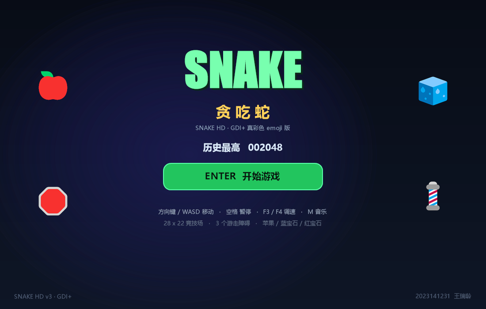
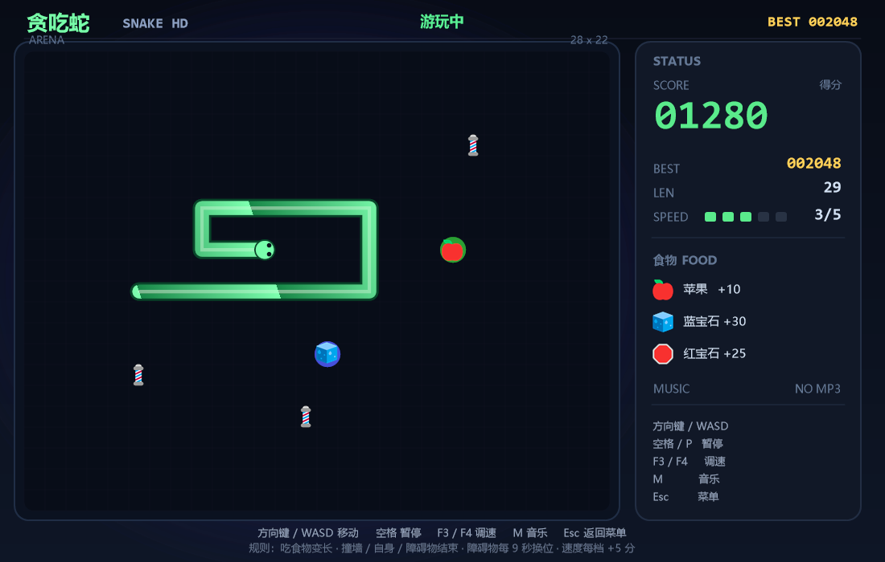
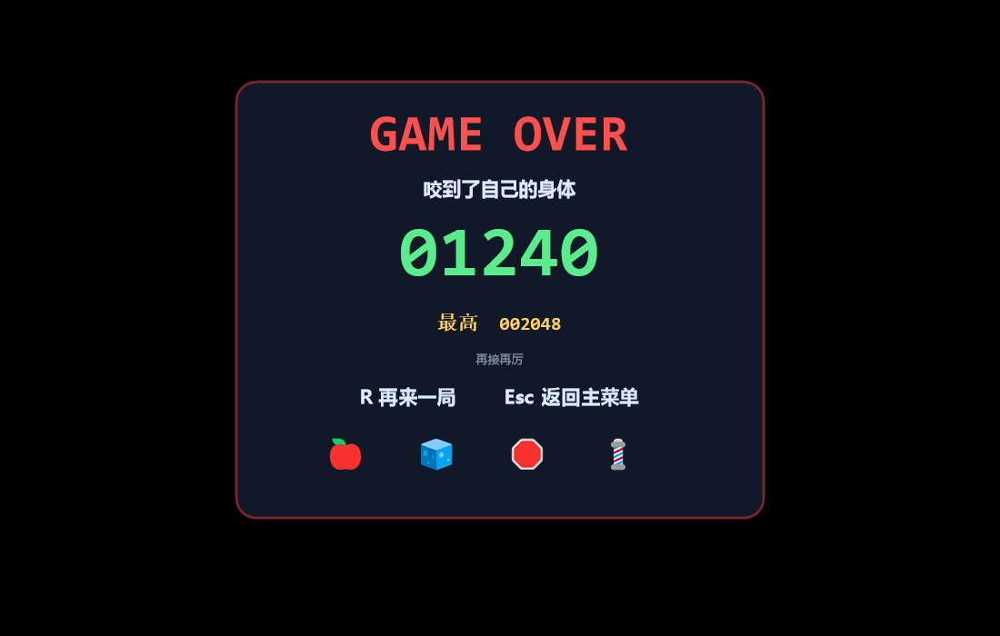

# 贪吃蛇 · SNAKE HD

> 2023141231 王瑞龄 · 课程实训项目

一个 C / C++ 实现的贪吃蛇，包含两个版本：

- **GDI+ 真彩色窗口版**：1100×700 窗口，圆角渐变蛇身、真彩色 emoji（🍎 🧊 🛑 💈）、粒子、音效、完整菜单/暂停/结算。
- **控制台版**：纯 C + Win32 Console，100×29 字符，双缓冲、线框 HUD、像素字分数。

两个版本共用同一套游戏逻辑（`game.c` / `game.h`），原课程代码保留在 `原版源码/`。

## 界面

**主菜单（真彩色 emoji）**



**游戏中**



**结算**



## 直接玩（无需安装环境）

Windows 10 / 11 **64 位**，解压或克隆后：

```bat
打开真彩色版.bat
```

或者双击：

```text
snake_gui\snake_gui.exe
```

控制台版：

```bat
打开控制台版.bat
```

不需要安装 Python、Code::Blocks、MinGW 或 .NET 运行库。两个 exe 都静态链接，只依赖 Windows 自带 DLL。

- 第一次运行如遇 SmartScreen：**更多信息 → 仍要运行**。
- 不要只把 `snake_gui.exe` 单独复制出去：`emoji/`、`sounds/` 必须和它在同一目录。
- 64 位 exe，32 位 Windows 需要重新编译。

## 操作

| 按键 | 功能 |
|---|---|
| 方向键 / WASD | 移动 |
| 空格 / P | 暂停 / 继续 |
| F3 / F4 | 加速 / 减速（1–5 档，默认 3 档） |
| M | 背景音乐开关 |
| Esc | 游戏中返回菜单；菜单中退出 |
| Enter / 空格 | 菜单开始；结算再来一局 |
| R | 结算重开 |

默认 **3 档（155ms/步）**；按下方向键后蛇头立即转向，身体在下一个逻辑步移动。

## 目录

```text
.
├─ 打开真彩色版.bat
├─ 打开控制台版.bat
├─ kldykxq.mp3                  背景音乐
├─ 使用说明.txt
├─ 代码审查与优化报告.md         原版问题清单 + 优化说明
├─ 课程实训报告.docx
├─ snake_gui/                   GDI+ 真彩色版：exe + C++/C 源码 + emoji + 音效
├─ snake_hd/                    控制台版：exe + C 源码 + 音效
└─ 原版源码/                     最初的课程代码（未改动）
```

每个版本目录内都有 `README.md` 和 Code::Blocks 工程 / 构建脚本。

## 构建（可选，玩家不需要）

需要 Code::Blocks + MinGW-w64：

- 控制台版：`snake_hd\build.bat` 或 `snake_hd.cbp`
- GDI+ 版：`snake_gui\build_gui.bat` 或 `snake_gui.cbp`

原版 `原版源码/tcs.cbp` 引用了已不存在的 `map.c` / `mywindows.c`，且没有链接 winmm，不能直接构建；具体原因见 `代码审查与优化报告.md`。

## 技术点

- 蛇身：头尾双指针链表，移动时复用尾节点，零逐帧分配；
- 碰撞：`occ[22][28]` 占用表，O(1) 判定墙/自身/障碍；
- 计时：`QueryPerformanceCounter` + 固定步长累加器；
- 输入：方向队列（最多 3 次转向），按键立即转头；
- 生成：食物避开蛇/障碍；障碍物换位前预警，且不会刷在蛇头前方；
- 控制台渲染：整帧 `CHAR_INFO` 双缓冲 + 默认 16 色 + 纯黑背景；
- GDI+ 渲染：圆角路径、渐变、alpha 面板、真彩色 emoji PNG；
- 音效：WAV + `PlaySound(SND_ASYNC)`；背景音乐 MCI。

## 说明

- 仅供课程学习与交流使用。
- emoji 由系统 Segoe UI Emoji 预渲染成 PNG，已随仓库打包，不依赖接收方字体。