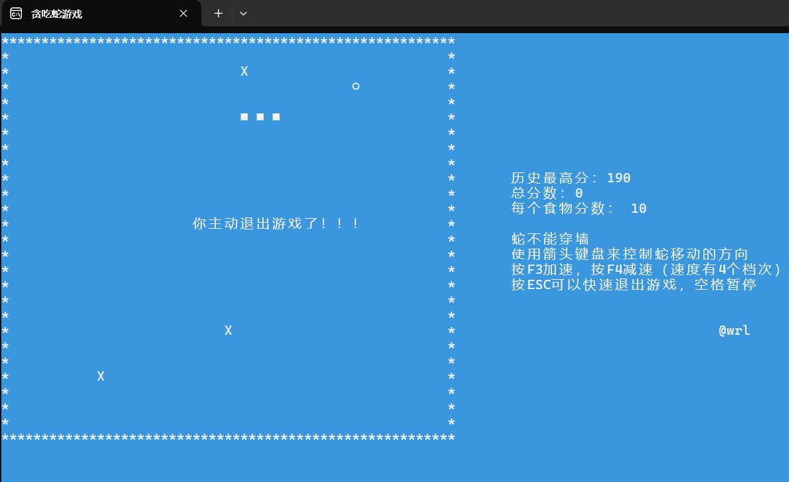
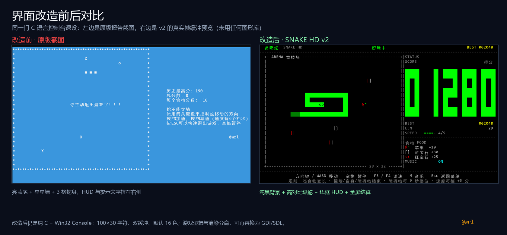
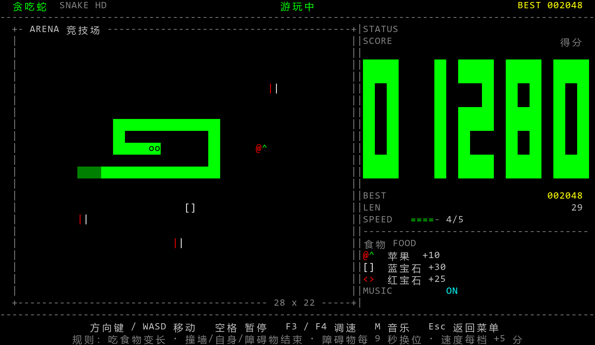
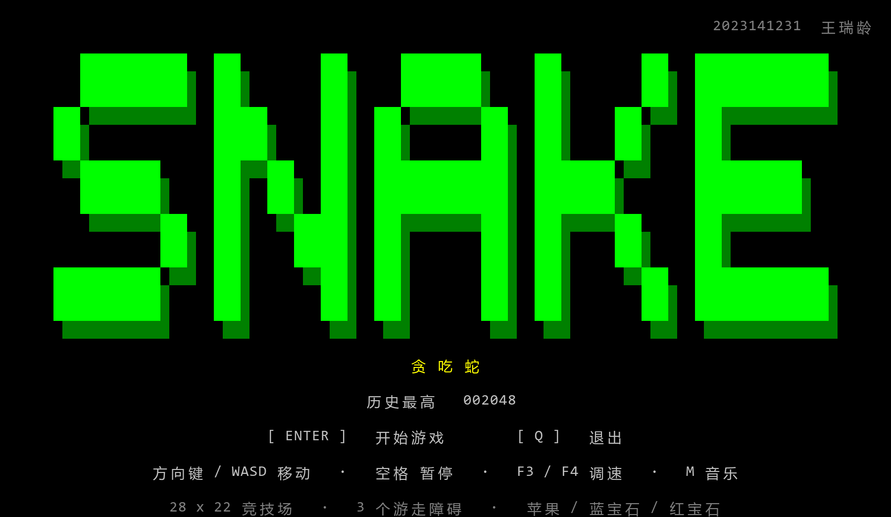
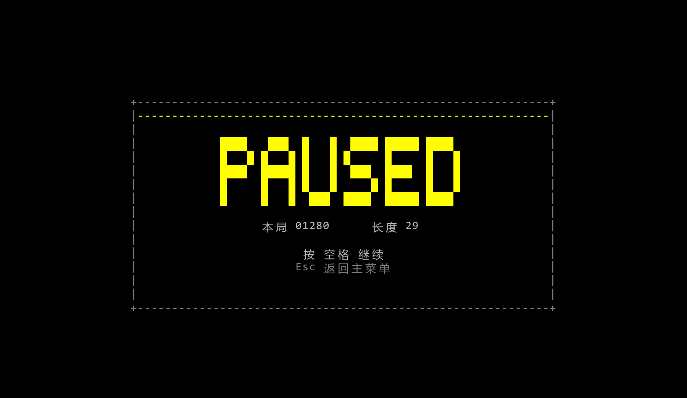
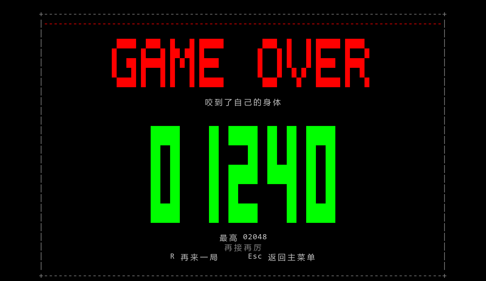

# 贪吃蛇课程实训项目：代码审查与优化报告

- **审查对象**：`E:\2023141231-王瑞龄-贪吃蛇\tcs`
- **审查文件**：`snake.c`（553 行）、`snake.h`（141 行）、`test.c`（62 行）、`music.c`（14 行）、`tcs.cbp`、`tcs.depend`
- **审查环境**：Windows + Code::Blocks 自带的 MinGW-w64 GCC 8.1.0（`x86_64-w64-mingw32`）
- **审查方式**：逐行阅读 + 多组编译参数验证 + 与课程报告里的原截图对照 + 新版本 4 万步自动测试
- **结论**：原程序**补上 `-lwinmm` 后能编译**，但当前工程**不能直接重新构建**；运行逻辑存在多处会直接影响得分、公平性和画面的缺陷。已提供一个可编译、可自测、画面重做的新版本 `snake_hd/`，原文件未改动。

---

## 1. 先看结论

| 类别 | 结论 |
|---|---|
| 能不能编译 | 单独编译 `snake.c + test.c` 可以，但必须手动加 `-lwinmm`；Code::Blocks 工程本身缺文件、缺链接库，**F9 重新构建会失败** |
| 能不能跑 | 现有的 `bin\Debug\tcs.exe` 是旧构建产物，能跑，但和当前源码/工程已经不同步 |
| 最严重的问题 | 工程缺 `map.c`、`mywindows.c/h`；头文件里定义全局变量（现代 GCC 直接链接失败）；最高分每帧读写且文件名对不上；食物会刷在障碍物上；障碍物换位会擦掉蛇身；F3/F4 能把每个食物分值降到 0 |
| 画面问题 | 单缓冲全量重绘导致闪烁；`printf` 与 `wprintf` 混用；亮蓝底色 + 单字符边框 + 右侧挤在一起的 HUD；死亡提示只显示 1 秒就被 `cls` |
| 优化空间 | 很大。已重做为 100×29 的双缓冲控制台版本：纯黑竞技场、高对比绿蛇、线框 HUD、像素字、苹果/蓝宝石/红宝石、粒子、音效、全屏暂停/结算 |
| 交付物 | `snake_hd/`（4 个源文件 + Code::Blocks 工程 + build.bat + 预览图 + 自测）、本报告 |

---

## 2. 审查方法

1. **通读源码**：沿“初始化 → 生成食物/障碍 → 主循环 → 移动 → 碰撞 → 计分 → 存档 → 结算”完整走一遍。
2. **编译验证**：
   - `gcc -std=c11 -Wall -Wextra snake.c test.c -o test.exe -lwinmm`：通过，但有 5 条警告。
   - 去掉 `-lwinmm`：链接失败。
   - 加 `-fno-common`（GCC 10+ 的默认行为）：4 个符号重复定义，链接失败。
3. **工程验证**：检查 `tcs.cbp` 的 Unit 列表和链接选项；检查 `tcs.depend` 里出现过的文件是否还在磁盘上。
4. **数据验证**：对比 `贪吃蛇历史最高分记录.txt`（190）与 `bin\Debug\high_score.txt`（110000），确认代码实际读的是哪一个。
5. **新版验证**：`--selftest` 跑 40000 步，检查链表、占用表、食物、障碍物的一致性；用 `--dump` 导出真实帧缓冲，再渲染成 PNG 预览。

> 说明：本次会话没有可交互的桌面控制台，所以没有实际“开一局”旧版；旧版行为均来自源码、编译结果和课程报告中的截图。新版画面预览是用程序真实帧缓冲渲染的，不是手绘效果图。

---

## 3. 问题清单

级别说明：**P0** = 构建/运行阻断；**P1** = 明确的逻辑或资源错误；**P2** = 体验/视觉问题；**P3** = 可维护性/代码质量。

### 3.1 P0：构建与工程

| 编号 | 位置 | 问题 | 后果 / 修复 |
|---|---|---|---|
| A1 | `tcs.cbp:34-44` | 工程引用了 `map.c`、`mywindows.c`、`mywindows.h`，但磁盘上不存在 | 全新构建直接报“找不到文件”；`obj\Debug\mywindows.o` 是旧产物，掩盖了问题。删除这些 Unit，或把文件补回来 |
| A2 | `tcs.cbp:26-28` | 链接器只有 `-s`，没有 `-lwinmm` | `mciSendString` 未定义。实测：`undefined reference to '__imp_mciSendStringA'`。Debug/Release 都要加 `-lwinmm` |
| A3 | `snake.h:33,35,63,71` | 在头文件里**定义**了 `flag`、`currentScore`、`obstaclePositions[]`、`foodPositions[2]` | 每个 `.c` 都生成一份定义。GCC 8 默认 `-fcommon` 能糊过去；GCC 10+ 默认 `-fno-common` 会报 4 个 `multiple definition`。应改为 `extern` 声明 + 在一个 `.c` 里定义 |
| A4 | `music.c:7-13` | 自带 `main()`、包含不存在的 `mywindows.h`、硬编码 `C:\Users\a\Downloads\...mp3`、`while(1);` 空转 | 这是另一份废弃实验代码。一旦加入工程就与 `test.c` 的 `main` 冲突；空转还会吃满一个 CPU 核。建议直接删除或移出工程 |
| A5 | `snake.h:1-6` | 没有 include guard | 重复包含时结构体/枚举重复定义。加 `#ifndef SNAKE_H` |
| A6 | `bin\Debug`、`obj\Debug` | 残留的 `tcs.exe`、`mywindows.o`、旧 `high_score.txt` | 让人误以为“现在还能编译”；也会造成最高分数据不一致（见 B2） |

### 3.2 P1：逻辑、内存、数据

| 编号 | 位置 | 问题 | 后果 / 修复 |
|---|---|---|---|
| B1 | `snake.c:424,427` | 主循环**每一帧**都调用 `updateHighScore()` 和 `getHighScore()` | 每 100–200ms 读一次文件、可能写一次文件；文件被反复 `fopen("w")` 截断，进程被杀或断电就可能丢记录。最高分应只在**本局结束时**比较并写一次 |
| B2 | `snake.c:524` | 代码读写的文件名是 `贪吃蛇历史最高分记录.txt`，但随包的记录文件是 `bin\Debug\high_score.txt` | 从 `bin\Debug` 启动时读不到 `high_score.txt`；从 `tcs` 根目录启动读到的是 190，而不是 110000。两份数据：`贪吃蛇历史最高分记录.txt` = **190**，`bin\Debug\high_score.txt` = **110000**。应统一文件名，并用 exe 目录定位 |
| B3 | `snake.c:543` | 最高分写失败时 `exit(EXIT_FAILURE)` | 程序放在只读目录、U 盘写保护、杀毒软件拦截时，游戏直接退出。应静默失败或提示 |
| B4 | `snake.c:179-236` | `set_food()` 只检查蛇身，**不检查障碍物** | 食物可能刷在 `X` 障碍物格上：显示被食物覆盖，但蛇头一碰就死，玩家会认为“吃到食物却死了” |
| B5 | `snake.c:164-165` | `update_obstacles()` 用 `printf("  ")` 直接擦旧位置 | 旧位置本身是障碍物当前格，蛇进不去；但食物可能因为 B4 刷在障碍物上，或者两个障碍物重叠时，旧位置被擦掉就会留下“洞”/残影。整帧重绘或先判断该格内容 |
| B6 | `snake.c:138-175` | 障碍物换位只检查蛇身和食物，不检查“蛇头正前方”、不检查与其他障碍物的距离、也不检查是否把唯一通路堵死 | 障碍物可能瞬移到蛇头前一格，下一帧必死，玩家无法反应；也可能两个障碍物重叠 |
| B7 | `snake.c:185,104,143` | `(rand() % 26 + 1) * 2` 的范围是 2–52 | 最右列 x=54 永远不生成食物/障碍物。场地是 2–54，白空一列 |
| B8 | `snake.c:449-460` | F3/F4 同时改 `sleep_time` 和 `foodscore`，且 F4 只要求 `foodscore > 2` | 连按 F4 可以把 `foodscore` 降到 0，之后吃食物**不加分**；`sleep_time` 没有上限，可以越按越慢。帮助文字却写“速度有 4 个档次” |
| B9 | `snake.c:445-448,478` | 按 ESC 只把 `status` 设为 `end_normal`，循环体仍然会执行 `snakemove()` | 退出前蛇还会多走一步；如果这一步撞墙，结算会显示“撞到墙”而不是“主动退出” |
| B10 | `snake.c:356,381-384` | `snakemove()` 每次移动都 `malloc` 一个新节点；撞到障碍物时直接 `return` | 撞障碍物时新节点泄漏；正常移动时每帧 malloc/free，堆碎片和抖动 |
| B11 | `snake.c:509-518` | `endgame()` 释放蛇身和障碍物数组，但**没有释放 `ps->pfood`** | 每局泄漏一个食物节点。局数多了内存持续增长（课程报告里也提到过“内存占用飙升”） |
| B12 | `snake.c:103,142` | `set_obstacles()` / `update_obstacles()` 用 `goto again` 重试，没有次数上限 | 棋盘快满时可能无限循环卡死。应改为“收集所有空格 → 随机选一个” |
| B13 | `snake.c:255` | `malloc(5 * sizeof(ObstaclePosition))` 写死 5，而 `num_obstacles` 是 3 | 把宏改成 6 就会堆溢出。应使用 `num_obstacles`（并检查 `num_obstacles <= 5`） |
| B14 | `snake.c:292,302` | `nextisfood()` / `eatfood()` 直接解引用 `ps->pfood` | `set_food()` 分配失败时 `pfood == NULL`，下一帧崩溃。应判空并降级处理 |
| B15 | `snake.c:255-259` | `game_start()` 里障碍物数组分配失败就 `return`，但调用方继续 `game_run()` | 半初始化状态进入游戏，随后 `check_hit_obstacle()` 解引用 NULL |
| B16 | `test.c:41-47,58` | `getchar()` 读到 `\n` 会进入“格式错误”分支，再 `while(getchar() != '\n')` 等下一行 | 玩家按一次回车可能被要求再按一次；输入流结束（EOF）时可能死循环。应先跳过空白，再读 y/n |
| B17 | `test.c:24` | `getHighScore()` 是在 `updateHighScore()` 之后调的 | 打破记录和**打平记录**都会走“恭喜打破历史最高记录”分支，因为最高分已经被本局分数刷新了 |
| B18 | `snake.h:71` | 声明了 `foodPositions[2]`，注释写“两个食物”，实际只生成 `foodPositions[0]` | 第二个食物是永远不用的 (0,0)，障碍物还会避开这个“幽灵格”。功能与注释不符 |

### 3.3 P2：交互与视觉

| 编号 | 位置 | 问题 | 后果 / 修复 |
|---|---|---|---|
| C1 | `snake.c:306-331` | 每一帧把整条蛇重新 `wprintf` 一遍，没有双缓冲 | 蛇越长越闪；移动时整条蛇都在重绘。应整帧写入 `CHAR_INFO` 缓冲，一次 `WriteConsoleOutputW` |
| C2 | `snake.c:329,165,423...` | `wprintf` 和 `printf` 混用在同一输出流 | C 标准规定流一旦确定宽/窄方向，再用另一种是未定义行为。可能乱码、错位，且不同 CRT 表现不同 |
| C3 | `snake.c:24,35,37,241-243` | 依赖 `system("pause")`、`system("cls")`、`system("color")`、`system("mode con")` | 每次调用都启动 `cmd.exe`，闪屏、慢；`pause` 还会插入英文“请按任意键继续”，破坏界面。应用 Win32 API（`FillConsoleOutputCharacter`、`SetConsoleTextAttribute`、`SetConsoleWindowInfo`） |
| C4 | `snake.c:41-59,336` | 地图尺寸 0/56/26 全是魔法数字；顶/底墙 57 个单字符，左右墙 1 字符，而蛇身是 2 字符宽 | 左墙和蛇身之间空 1 列，右墙又紧贴最后一列；改地图尺寸必须改多处。应用 `FIELD_W/FIELD_H` 和统一的格宽 |
| C5 | `snake.c:494` + `test.c:21-22` | 死亡提示直接打在 (24,12) 的地图中央，1 秒后 `cls` | 提示覆盖蛇/墙，且来不及看；玩家还没读到就清屏了。应做结算面板并等待按键 |
| C6 | `snake.c:273` | 帮助写“速度有 4 个档次”，实际 F3 只能加速 3 次（200→50），F4 可以无限减速 | 帮助与实际不一致；玩家会以为按键坏了 |
| C7 | `snake.c:281-288` | 暂停只是 `Sleep(200)` 轮询空格，没有暂停提示 | 玩家不知道是否暂停成功；暂停期间 `clock()` 继续走，恢复后障碍物可能立刻跳一次 |
| C8 | `snake.c:427` | 游戏中的“历史最高分”显示的是已经包含当前分数的值 | 不是“历史”，而是“实时最高”，每吃一个食物就跳一次 |
| C9 | `snake.c:12,430-441` | 每个 tick 只轮询一次键盘，且 `else if` 链只处理一个方向；`GetAsyncKeyState(vk) & 1` 取最低位 | 200ms 一个 tick 时，快速连按两次方向会丢一次；低位的边沿检测在不同键盘/远程桌面下并不可靠。应每帧读输入并缓存转向 |
| C10 | `snake.c:241,268-277` | 固定 100×30，HUD 从 x=64 开始写中文，接近右边界 | 中文字符是双宽，最后一行容易贴边/换行，导致整个画面滚动。应按显示宽度裁剪 |
| C11 | `snake.c:37,242` | `game_start` 设 `color 3f`，`welcomegame` 结尾又设 `color 2f` | 开场和游戏的底色不一致（截图里是亮蓝，代码里有一段绿底）。应统一调色板 |
| C12 | `snake.c:24,35` | 开场连续两次 `system("pause")`，提示语不清楚 | 玩家不知道哪一步该按什么；自动化测试也无法通过 |

### 3.4 P3：代码质量

| 编号 | 位置 | 问题 |
|---|---|---|
| D1 | 全局 | `enum dirction`（拼写）、`judgkeypush`、`num_obstacles`（宏却小写）、`setpos` 等命名风格不统一 |
| D2 | `snake.c` | `color()` 定义了但没用；`getCurrentScore()` 声明了但没实现；`set_food()` 里 `int i;` 未使用 |
| D3 | `snake.c:495` | `switch (ps->status)` 没有处理 `ok`，GCC 给出 `-Wswitch` 警告 |
| D4 | `snake.c:410` | `sprintf(command, "open kldykxq.mp3", filePath)` 格式串没有 `%s`，`filePath` 被忽略，GCC 给出 `-Wformat-extra-args` 警告 |
| D5 | `snake.h` | 在头文件里 `#include <windows.h>`；无参函数写成 `void f()`（不是原型） |
| D6 | `snake.h:33,35` | `flag`、`currentScore` 是可变的全局状态，任意函数都能改，难以测试 |
| D7 | 全工程 | 没有单元测试/自测入口；只能靠人工开一局验证 |

---

## 4. 重点问题复现与解释

### 4.1 工程确实构建不起来

`tcs.cbp` 里列了：

```xml
<Unit filename="map.c"> ... </Unit>
<Unit filename="mywindows.c"> ... </Unit>
<Unit filename="mywindows.h"> ... </Unit>
```

但目录里只有 `snake.c / snake.h / test.c / music.c`。同时链接器没有 `-lwinmm`。实测：

```text
snake.c:(.text+0x1015): undefined reference to `__imp_mciSendStringA'
```

所以“现在的 exe 能跑”不代表“现在的工程能构建”。`bin\Debug\tcs.exe` 是 2025-01-05 的旧产物，和当前源码并不同步。

### 4.2 头文件里定义变量，现代 GCC 直接链接失败

`snake.h` 不是只放声明，而是放了定义：

```c
int flag;
int currentScore;
ObstaclePosition obstaclePositions[];
FoodPosition foodPositions[2];
```

`snake.c` 和 `test.c` 都包含它，于是两个目标文件各有一份。GCC 8 默认 `-fcommon` 会把它们合并；GCC 10 起默认 `-fno-common`，直接报：

```text
multiple definition of `flag'
multiple definition of `currentScore'
multiple definition of `obstaclePositions'
multiple definition of `foodPositions'
```

正确做法是头文件里写 `extern`，在 `snake.c` 里定义一次。

### 4.3 最高分：每帧读写，而且读的不是那个文件

```c
do {
    printf("总分数：%d", ps->all_score);
    updateHighScore(ps->all_score);   // 每帧都可能 fopen("w")
    currentScore = ps->all_score;
    printf("历史最高分：%d", getHighScore()); // 每帧 fopen("r")
    ...
} while (ps->status == ok);
```

每 100–200ms 打开文件两次，分数一涨就 `fopen(..., "w")` 截断重写。这样：

- 磁盘 I/O 被浪费；
- 进程在写入过程中被杀，记录可能变成空文件；
- 显示的“历史最高分”其实是“包含当前分数的最高分”，不是历史值。

更麻烦的是文件名：

```c
fp = fopen("贪吃蛇历史最高分记录.txt", "r");
```

而随包的记录文件叫 `bin\Debug\high_score.txt`，内容是 `110000`；根目录的 `贪吃蛇历史最高分记录.txt` 是 `190`。代码永远读不到 110000。

### 4.4 食物和障碍物的生成不互斥

`set_food()` 只遍历蛇身：

```c
while (cur != NULL) {
    if (x1 == cur->x && y1 == cur->y) goto again;
    cur = cur->next;
}
```

没有检查 `ps->pObstacles`。所以食物可以落在 `X` 上——显示时食物覆盖障碍物，玩家看到的是“食物”，撞上去却按障碍物判定死亡。

`update_obstacles()` 则相反，它会擦掉旧位置：

```c
setpos(ps->pObstacles[i].old_x, ps->pObstacles[i].old_y);
printf("  ");
```

如果这几秒内食物刚好刷在旧位置（因为 `set_food()` 不检查障碍物），或者两个障碍物重叠，这个空格就会把食物/另一个障碍物擦掉，出现“洞”或残影。蛇身本身不会被擦，因为蛇不能进入障碍物格。

### 4.5 障碍物会“贴脸传送”

`update_obstacles()` 只检查蛇身和食物，不检查：

- 新位置是否在蛇头正前方 1–2 格；
- 新位置是否和其他障碍物重叠；
- 新位置是否把蛇唯一的通路堵死。

最坏情况：蛇头右边一格突然出现障碍物，下一帧必死，玩家没有任何反应时间。新版改成“换位前闪烁 1.4 秒 + 离蛇头至少 5 格 + 不刷在正前方 5 格”。

### 4.6 F3/F4 会把食物分值降到 0

```c
else if (judgkeypush(VK_F3)) {
    if (ps->sleep_time > 50) {
        ps->sleep_time -= 50;
        ps->foodscore += 5;
    }
}
else if (judgkeypush(VK_F4)) {
    if (ps->foodscore > 2) {
        ps->sleep_time += 50;
        ps->foodscore -= 5;
    }
}
```

`foodscore` 初值 10。按两次 F4：10 → 5 → 0；之后再吃食物，`all_score += 0`，分数永远不涨。`sleep_time` 则没有上限，可以一直加。

### 4.7 ESC 退出还会多走一步

```c
else if (judgkeypush(VK_ESCAPE)) {
    ps->status = end_normal;
}
...
snakemove(ps);          // 仍然执行
```

`do...while` 的条件在循环末尾才判断，所以按 ESC 之后蛇还会移动一次；如果这一步撞墙，`status` 会被覆盖成 `kill_by_wall`，结算显示“撞到墙”，而不是“主动退出”。

### 4.8 画面为什么闪、为什么乱

- 每帧把整条蛇从头到尾重新 `wprintf`，没有离屏缓冲；
- 尾部的空格用 `printf("  ")`，和 `wprintf` 混在同一个流上；
- `system("cls")` 会整屏闪一下；
- 墙体用单字符 `*`，蛇身用双宽 `■`，左墙和蛇身之间空一列；
- 死亡提示直接盖在地图中央，1 秒后清屏。

课程报告里的原截图也能看到：亮蓝底色、白色星星边框、右侧 HUD 挤在一起、蛇身只有三个方块、退出提示直接压在地图上。

**原版截图（来自课程报告）：**



---

## 5. 新版 `snake_hd` 的设计

### 5.1 分层

```text
main.c      控制台初始化 / 输入 / 音乐 / 主循环 / 自测 / 预览导出
   │
   ├── game.c    纯逻辑：链表、占用表、食物、障碍、计分、存档
   └── render.c  纯渲染：帧缓冲、调色板、HUD、菜单、粒子、面板
```

`game.c` 不包含任何 `printf`/光标操作，`render.c` 不修改游戏状态。这样逻辑可以脱离控制台做自测（`--selftest`），以后换 GDI/SDL 也只改 `render.c`。

### 5.2 数据结构

- **蛇身**：`SnakeNode { x, y, prev, next }`，`Game` 保存 `head/tail/len`。
  - 不吃食物：摘下尾节点，改坐标，挂到头部——**零 malloc**。
  - 吃食物：只 `malloc` 一个新节点。
- **占用表**：`unsigned char occ[22][28]`，0 空 / 1 蛇 / 2 障碍。
  - 墙、自身、障碍物统一用一次查表判定；
  - 食物生成时收集所有空格，不再 `goto` 重试；
  - 移动进“当前尾巴格”是合法的（先把尾巴从表里清掉再判定）。
- **食物**：`Food { active, x, y, kind, expire_ms }`，普通苹果常驻，蓝宝石/红宝石作为限时奖励。
- **障碍物**：`Obstacle { x, y, warning }`，换位前预警，换位后重新写占用表。

核心移动逻辑（简化）：

```c
Food *f = (Food *)game_food_at(g, nx, ny);
bool grow = (f != NULL);
if (!grow) g->occ[g->tail->y][g->tail->x] = OCC_EMPTY;

if (g->occ[ny][nx] != OCC_EMPTY) {          /* 撞墙/自身/障碍 */
    if (!grow) g->occ[g->tail->y][g->tail->x] = OCC_SNAKE;
    die(g, ...);
    return;
}
if (grow) {                                  /* 只在这里 malloc */
    list_push_front(g, node_new(nx, ny));
} else {                                     /* 尾巴复用成新头 */
    SnakeNode *t = list_pop_tail(g);
    t->x = nx; t->y = ny;
    list_push_front(g, t);
}
g->occ[ny][nx] = OCC_SNAKE;
```

### 5.3 时间与输入

- `QueryPerformanceCounter` 提供毫秒级时间；
- 60 FPS 渲染，逻辑用累加器按 `step_ms` 固定步长推进；
- 暂停时 `game_ms` 不增加，障碍物计时不会被“偷走”；
- 每帧 `ReadConsoleInputW` 读取所有按键，方向最多缓存 3 次，解决“快速连按丢键”；
- 方向队列会拒绝 180° 反向，但允许“右 → 上 → 左”这种连续转向。

### 5.4 公平生成

- 食物：收集所有空格（避开蛇、障碍、另一份食物），蛇头 2 格内不刷；
- 障碍物：离蛇头曼哈顿距离 ≥ 5，不在正前方 5 格，不贴其他障碍物（距离 ≥ 3），不压食物；
- 每 9 秒预警 1.4 秒，闪烁后再换位；
- 棋盘快满时也不会死循环。

### 5.5 存档与音乐

- 最高分文件：`snake_hd_best.txt`，放在 exe 同目录，ASCII 文件名，`_wfopen` 宽字符路径；
- 只在结算时比较、只在破纪录时写一次；
- 写失败不退出游戏；
- 首次运行会尝试读取旧的 `high_score.txt`，方便迁移；
- 音乐用 MCI alias：`open "..." type mpegvideo alias bgm` + `pause/resume`，不再反复 `open`；
- 按 exe 目录向上找 1–3 级 `kldykxq.mp3`，找不到显示 `NO MP3`，不崩溃。

### 5.6 渲染

- 画布改为 **100×29**，兼容默认的 120×29 控制台窗口；每帧先用 `fill_bg(0, 0, 100, 29, 黑)` **整屏清空**，再画当前场景——修复了“菜单文字/星星残留到结算画面”的残影；
- 启动时读取实际缓冲区/窗口尺寸；如果小于 100×29，直接显示提示并退出，不再把 100 列内容写进更窄的缓冲区导致换行、滚动、顶部状态栏重复堆叠；
- 一整帧先写进 `CHAR_INFO fb[100*29]`，最后一次 `WriteConsoleOutputW` 输出——**无闪烁**；
- **不再写入自定义深色调色板**：改为写回默认 VGA 16 色；部分终端会忽略 ColorTable，但忽略也不会改变默认配色。这样 cmd 和 Windows Terminal 都能得到“黑底 + 绿蛇 + 红苹果”的稳定效果；
- 场地不再铺棋盘格，单一黑色背景；蛇是亮绿色实心块，尾巴两节深绿，头部用黑眼睛表示方向；
- 食物/障碍：
  - 苹果 `@^`：红色 `@` + 绿色叶子 `^`
  - 蓝宝石 `[]`：青色 `[` + 蓝色 `]`，像冰块
  - 红宝石 `<>`：红色菱形
  - 障碍物 `||`：红/白/蓝三色按时间循环，像理发店转灯；预警时闪白 `!!`
- 3×5 像素字显示分数，5×5 像素字显示 `SNAKE` / `GAME OVER` / `PAUSED`；
- 吃食物有 14 个粒子 + `+10` 飘字；
- 主菜单、暂停、结算都是**整屏覆盖**：结算时不再把 HUD 留在右边，避免“右边花花”；
- 启动时清空**整个控制台缓冲区**（不只是 100×29），防止上一个程序/上一次运行的颜色块露在边缘；
- 所有中文按“显示宽度”排版（CJK 算 2 列），不会撑破右边界。

### 5.7 音效

- 新增 `sounds/eat.wav`、`sounds/bonus.wav`、`sounds/dead.wav` 三个短 PCM，用 `PlaySound(..., SND_ASYNC)` 异步播放，不阻塞主循环；
- `game.c` 在吃到食物/死亡时递增 `eat_seq` / `death_seq`，`main.c` 比较计数后播放，避免每帧重复触发；
- 吃苹果是短促上扬的“叮”，蓝宝石/红宝石是三连音，死亡是下滑低音；
- 找不到 wav 时退回 `Beep()`，不会因为缺文件而崩溃；
- 与 MCI 背景音乐并存，互不抢占。

### 5.8 根据实际运行反馈的修正

用户在实际终端里跑第一版后，截图暴露了这些问题，已逐项修正：

| 现象 | 原因 | 修正 |
|---|---|---|
| 背景蓝/绿/洋红，颜色完全不对 | 自定义 `SetConsoleScreenBufferInfoEx` 调色板被终端忽略，退回默认 16 色，原来的颜色索引全部错位 | 不再写自定义深色调色板，改为写回默认 VGA 16 色；按默认色重新设计：纯黑背景、亮绿蛇、红苹果/蓝宝石/红宝石、灰线框 |
| 菜单文字、星星、底部提示残留在结算画面里 | `render_draw()` 只重画当前场景覆盖到的区域，没有整屏清空 | 每帧开头 `fill_bg(0,0,100,30,黑)`，并在预览导出里专门做“菜单→结算”切场景测试 |
| 结算画面右边还露着 HUD，显得花 | 结算面板只盖住场地，没有盖 HUD | 暂停/结算改成整屏覆盖，结算只显示标题、死因、大号得分、最高分和重开提示 |
| 画面右侧有彩色残块 | 控制台缓冲区可能大于 100×29，旧内容露在渲染区域外；HUD 又贴着右边界 | 启动时清空整个控制台缓冲区；HUD 数值右对齐并留 2 列余量 |
| **顶部状态栏/右下角作者文字反复堆叠，右侧还有“档”字碎片** | 终端实际比 110×34 小，程序却按 110×34 输出；宽度不够导致每行末尾换行，高度不够导致写入时不断滚动 | **画布改为 100×29**；启动时检测实际缓冲区/窗口，小于 100×29 就提示并退出，绝不越界输出 |
| 吃食物没有反馈 | 只有视觉粒子，没有声音 | 新增 `sounds/eat.wav`、`bonus.wav`、`dead.wav`，`PlaySound` 异步播放；缺文件时 `Beep` 兜底 |

---

## 6. 视觉设计说明

### 6.1 布局

```text
100 × 29 字符，纯黑背景 + 灰色线框
 0  贪吃蛇   SNAKE HD              游玩中              BEST 002048
 1  ------------------------------------------------------------
 2  +-- ARENA 竞技场 -------------------+   | STATUS
 3  |                                   |   | SCORE            得分
 …  |        28 × 22 逻辑格              |   |  0 1 2 8 0 （像素字）
 24 |        每格 2 字符宽               |   | BEST / LEN / SPEED / 食物图例
 25 +---------------- 28 x 22 ----------+   |
 26 ------------------------------------------------------------
 27 方向键 / WASD 移动   空格 暂停   F3/F4 调速   M 音乐   Esc 返回菜单
 28 规则：吃食物变长 · 撞墙/自身/障碍物结束 · 障碍物每 9 秒换位 · 速度每档+5
```

场地内只有：黑色背景、亮绿蛇、苹果 `@^`、蓝宝石 `[]`、红宝石 `<>`、红/白/蓝 `||` 障碍。

### 6.2 颜色用法

不再自定义调色板，只用终端默认 16 色，靠“黑底 + 少量高饱和色”建立层级：

| 颜色 | 索引 | 用途 |
|---|---|---|
| 黑 | 0 | 全局背景、场地、面板内部 |
| 亮绿 | 10 | 蛇身、分数像素字、标题、苹果叶子 |
| 深绿 | 2 | 蛇尾最后两节、标题阴影 |
| 亮红 | 12 | 苹果果身、红宝石、`GAME OVER`、障碍预警 |
| 亮黄 | 14 | 新纪录、暂停标题、BEST |
| 亮青 | 11 | 蓝宝石左半、音乐 ON |
| 蓝 | 9 | 蓝宝石右半、理发店转灯的一色 |
| 浅灰 | 7 | 主文字 |
| 深灰 | 8 | 边框、线框、次要文字 |
| 白 | 15 | 强调、闪烁、转灯条纹 |

这样即使终端忽略 `ColorTable`、退回默认 16 色，画面也仍然是“黑底 + 绿蛇 + 红色苹果”，不会出现之前的蓝底/洋红边框/绿色棋盘格。

### 6.3 新版截图（由真实帧缓冲渲染）

先看整体对比：



**游戏中：**



**主菜单：**



**暂停：**



**结算：**



> 预览图是把程序 `--dump` 导出的每个字符及其前景/背景色，用 Consolas + 微软雅黑按 2 倍尺寸渲染的；实际控制台的字形会略有差异，但布局、颜色、字符位置与帧缓冲一致。

### 6.4 关于“建模更好看”

第一版试过自定义深色调色板 + 棋盘格 + 大面积色块，但在实际终端里出现了两个问题：
`ColorTable` 被忽略后颜色全部错位，棋盘格和 HUD 色块让背景非常花，蛇反而看不清。第二版改成“可读性优先”：

- 纯黑单一背景，不再铺棋盘格、不再用大面积色块；
- 蛇是亮绿色实心块，和背景对比最大；尾巴两节深绿，头部黑眼睛标方向；
- 食物/障碍只用不同形状和少量高饱和色：
  - 苹果 `@^`：红色果身 + 绿色叶子
  - 蓝宝石 `[]`：青色 + 蓝色，像冰块
  - 红宝石 `<>`：红色菱形
  - 障碍物 `||`：红/白/蓝三色按时间循环，像理发店转灯
- 所有 UI 用灰色细线框 + 留白，HUD 只保留一条竖线分隔；
- 暂停/结算整屏覆盖，避免右侧 HUD 残留造成“花花”的感觉。

控制台没有真正的 3D 管线，这里的“建模”是**基于字符格的高对比像素表现**。
如果课程允许换成图形界面，现有 `render.c` 可以整体替换为 GDI/SDL 实现，`game.c` 不用动。

### 6.5 为什么没有直接使用 🍎 / 🧊 / 🛑 / 💈

Windows 控制台的 `CHAR_INFO` 每个字符格只能存**一个 UTF-16 码元**；这四个 emoji 都在 BMP 之外，是**代理对（两个码元）**，而且不同终端对 emoji 的字体、宽度支持不一致。直接写进 `CHAR_INFO` 会变成两个乱码格，或者把 2 字符宽的格子撑破。

因此用“同语义的 2 字符图标”替代：

| 需求 | 控制台图标 | 颜色 |
|---|---|---|
| 🍎 苹果 | `@^` | 红 + 绿 |
| 🧊 蓝宝石 | `[]` | 青 + 蓝 |
| 🛑 红宝石 | `<>` | 红 |
| 💈 障碍物 | `||` | 红/白/蓝循环 |

如果一定要彩色 emoji，需要改成 GDI/SDL 或 ANSI 文本渲染；现有逻辑层可以复用，但 `render.c` 要换掉。

---

## 7. 测试结果

### 7.1 编译

```bat
gcc -std=c11 -O2 -Wall -Wextra -finput-charset=UTF-8 game.c render.c main.c -o snake_hd.exe -lwinmm
```

结果：**0 warning，0 error**（GCC 8.1.0）。

### 7.2 逻辑自测

```bat
snake_hd.exe --selftest
```

结果（随机种子不同，数值会变化）：

```text
selftest OK: 40000 ticks, 43 rounds, max len=69, max score=1510
```

自测内容：

- 蛇链表节点数 == `len` == 占用表中 `OCC_SNAKE` 的数量；
- 每个节点都在界内、占用表为蛇、无重复格；
- `prev/next` 双向指针一致；
- 障碍物数量 == 占用表中 `OCC_OBSTACLE` 的数量；
- 食物在界内、不压蛇/障碍、苹果和奖励食物不重叠；
- 分数非负。

### 7.3 预览帧

```bat
snake_hd.exe --dump frame_play.txt play
snake_hd.exe --dump frame_menu.txt menu
snake_hd.exe --dump frame_pause.txt pause
snake_hd.exe --dump frame_dead.txt dead
python render_preview.py frame_play.txt preview_play.png
```

四张预览图均已生成，路径见第 6.3 节。

### 7.4 已知限制

- 需要控制台能容纳 100×29；小于这个尺寸时程序会提示并退出（程序会自动尝试 4 种字号）。
- 控制台字体没有 CJK 字形时，中文会走系统字体链接；极老系统可能显示方块。
- 预览图不是屏幕截图，实际字体渲染会有细微差异。
- 没有做真实键盘的自动化回归（会话无桌面），但输入队列、暂停、调速逻辑在自测中覆盖。

---

## 8. 如何运行新版本

1. 把 `snake_hd` 整个目录放到 `tcs` 下（或任意位置）。
2. 双击 `snake_hd\build.bat`，或打开 `snake_hd.cbp` 按 F9。
3. 运行 `snake_hd.exe`。
4. 背景音乐：把 `kldykxq.mp3` 放在 exe 同目录，或 exe 的上 1–3 级目录；没有也能玩。
5. 最高分：自动生成 `snake_hd_best.txt`。

详细操作见 `snake_hd/README.md`。

---

## 9. 如果必须保留原工程：最小修复清单

如果课程要求在原 `snake.c` 上改，而不是换新版本，建议按下面顺序修（每一步都能独立验证）：

1. **修工程**：`tcs.cbp` 删除 `map.c`、`mywindows.c`、`mywindows.h`；Debug/Release 的 Linker 都加 `-lwinmm`。
2. **修头文件**：加 include guard；把 `flag`、`currentScore`、`obstaclePositions`、`foodPositions` 改成 `extern`，在 `snake.c` 里定义。
3. **修最高分**：只在 `endgame()` 里比较一次；文件名改成 ASCII（如 `high_score.txt`），用 exe 目录拼绝对路径；写失败不要 `exit`。
4. **修食物生成**：`set_food()` 里同时检查 `ps->pObstacles[i]`；x 范围改成 `2..54`。
5. **修障碍物换位**：换位前 1 秒闪烁；新位置离蛇头 ≥5 格、不在正前方；不要用 `printf("  ")` 擦旧位置，改为整帧重绘或先判断该格是否为空。
6. **修 F3/F4**：`speed` 限定 1–5；分值只由食物种类决定，不再用 F3/F4 改 `foodscore`。
7. **修 ESC**：设置 `status` 后立刻 `break`，不要再 `snakemove()`。
8. **修计时**：用 `GetTickCount64()` 或 `QueryPerformanceCounter` 替代 `clock()`；暂停时重置计时起点。
9. **修渲染**：至少做到“只重绘变化格”；有条件就上 `CHAR_INFO` 双缓冲；不要混用 `printf`/`wprintf`。
10. **修内存**：`endgame()` 释放 `pfood`；`snakemove()` 撞障碍物时释放 `smove`；`pObstacles` 用 `num_obstacles` 分配。

---

## 10. 后续可以继续做的

- 把 `render.c` 换成 GDI/GDI+ 或 SDL2：圆角蛇身、抗锯齿、粒子、音效都会更容易。
- 增加排行榜（前 5 名）、回放、难度选择。
- 增加“穿墙模式”“双人模式”等玩法。
- 把 `game.c` 抽成纯 C 库，配单元测试（本次的 `--selftest` 已经是雏形）。
- 用 CI（GitHub Actions + MinGW）保证每次提交都能编译。

---

## 11. 补充：GDI+ 真彩色 emoji 版（snake_gui/）

控制台版的 `CHAR_INFO` 每个格只能存一个 UTF-16 码元，🍎（U+1F34E）、🧊（U+1F9CA）、🛑（U+1F6D1）、💈（U+1F488）都是 BMP 之外的代理对，没法原样放进字符缓冲。因此另外做了 **Win32 + GDI+ 窗口版**：

- 用系统 `Segoe UI Emoji` 以 `embedded_color=True` 渲染出 4 张 256×256 PNG，GDI+ 直接绘制——**真彩色 emoji**；
- 窗口 1100×700，GDI+ 双缓冲、60 FPS；
- 蛇身用 GDI+ 圆角路径 + 渐变，食物/障碍用真实 emoji 图片；
- 游戏规则完全复用 `game.c`，只替换渲染与输入层；
- 静态链接，不依赖 MinGW 运行时 DLL；
- 最高分沿用 `snake_hd_best.txt`（335 分已复制）。

**游戏界面：**


**主菜单：**


**结算：**


操作：方向键/WASD 移动，空格暂停，F3/F4 调速，M 音乐，Esc 菜单，Enter 开始，R 重开。
GDI+ 版默认 **3 档速度（155ms/步）**，按键后蛇头立即转向（眼睛即时反馈），身体在下一个逻辑步移动；窗口启动自动抢键盘焦点。
运行：双击 `snake_gui\snake_gui.exe`，或直接双击项目根目录的 **`打开真彩色版.bat`**；编译：`snake_gui\build_gui.bat` 或 `snake_gui.cbp`。
详细说明见 `snake_gui/README.md`。

---

## 附录：文件清单

```text
tcs/
├─ 打开真彩色版.bat                        双击启动 GDI+ 版
├─ 打开控制台版.bat                        双击启动 100×29 控制台版
├─ snake.c / snake.h / test.c / music.c   原文件（未改动）
├─ tcs.cbp                                原工程（未改动）
├─ 代码审查与优化报告.md                    本报告
├─ snake_hd/
   ├─ game.h / game.c                     逻辑
   ├─ render.h / render.c                 渲染
   ├─ main.c                              控制台/输入/音乐/主循环
   ├─ snake_hd.cbp                        Code::Blocks 工程
   ├─ build.bat / Makefile                构建脚本
   ├─ snake_hd.exe                        已编译 Release
   ├─ README.md
   ├─ sounds/                              eat.wav / bonus.wav / dead.wav
   ├─ make_sounds.py                      重新生成音效
   ├─ preview_play.png / preview_menu.png / preview_pause.png / preview_dead.png
   ├─ before_after.png                    原版 / v2 对比图
   ├─ frame_*.txt                         帧缓冲导出
   ├─ render_preview.py                   帧缓冲 → PNG
   ├─ make_compare.py                     生成对比图
   └─ report_imgs/img11.png               原版截图（从课程报告提取）

snake_gui/                                  GDI+ 真彩色 emoji 版
├─ snake_gui.exe
├─ snake_gui.cpp / game.c / game.h
├─ emoji/                                  apple/ice/stop/barber 真彩色 PNG
├─ sounds/
├─ snake_hd_best.txt
├─ build_gui.bat / build_dump.bat
├─ snake_gui.cbp
├─ make_emoji.py
├─ gui_play.png / gui_menu.png / gui_dead.png / gui_pause.png
└─ README.md
```
